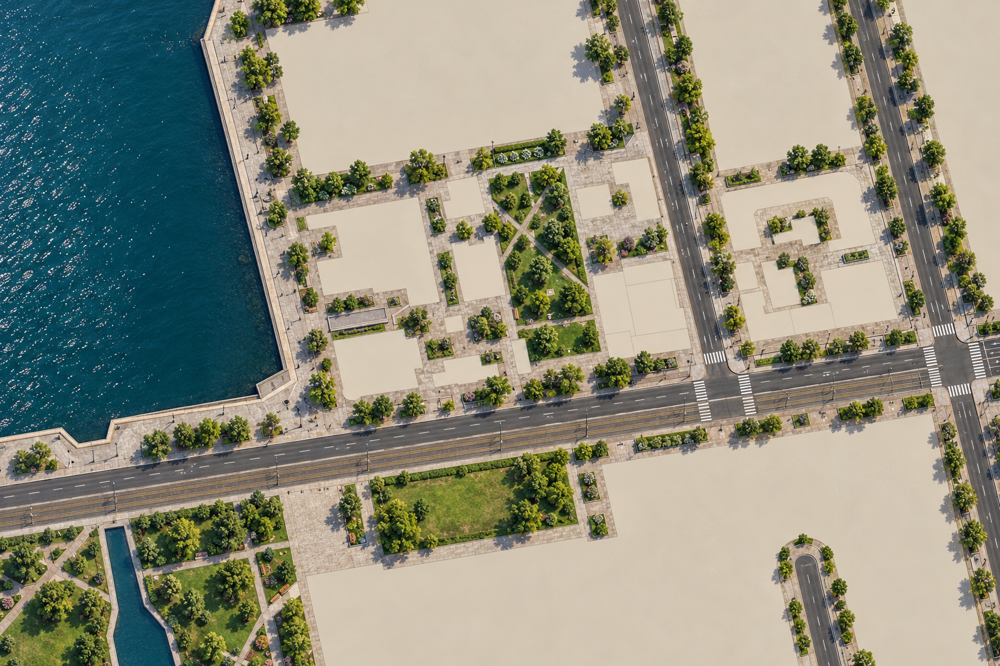
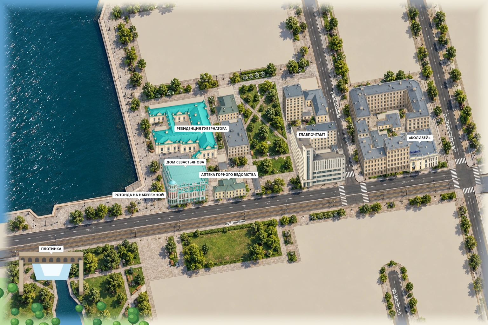

# Статичный фон пилотного квартала

Фотореалистичная земля квартала Дома Севастьянова и Главпочтамта: Городской пруд,
гранитная набережная, тротуары, дворы, сквер и озеленение. Здания, ротонда и памятник
накладываются отдельными спрайтами; в фон они не запечены.

- `guide.png` — геометрическая подложка из текущих данных и проекции карты: берег,
  улицы, зелёные зоны и точные контуры площадок под здания. Север сверху.
- `prompt.txt` — запрос к генератору. Входы: сначала `guide.png`, затем
  `public/prototype/assets/center_map.webp` как образец материалов и света.
- `codex-20261102.png` — исходное изображение, нормализованное к 1536×1024.
- `codex-20261102.frame.json` — кадр, зафиксированный до генерации; `frame.json` —
  те же координаты с ключом проекции для подключения.
- `src/map/data/backgrounds/sevastyanov/ground.webp` — текстура для игры (около 0,5 МБ),
  с прозрачным переходом шириной 48 пикселей к остальной карте.
- `src/map/data/backgrounds/sevastyanov.json` — размеры, мировая привязка, ключ проекции
  и список 21 отдельного объекта квартала.

`bounds` заданы в плоскости изображения карты: X — мировой X, Y — мировой Y × groundTilt.
Пиксель `(u, v)` соответствует точке
`(x0 + u / width × (x1 − x0), y0 + v / height × (y1 − y0))` этой плоскости.
При панорамировании и зуме фон и здания используют одну камеру.

Рендерер рисует фон после векторных улиц и воды, перед тенями и объектами. Процедурные
деревья внутри непрозрачной части заменены деревьями фона. Удаление здания показывает
игровой пустой участок поверх подложки; выделение и замена работают отдельно.
Если изображение не загрузилось или изменилась проекция земли (включая поле спрямления
улиц), остаётся векторная карта. Переключатель «Изображения / Модели» меняет здания;
статичное благоустройство остаётся на месте.

Стиль выбран пользователем 2 ноября 2026 года: фотореалистично, с птичьего полёта,
как в качественной игре и в исходном прототипе. Этот образец используется и для
18 недостающих изображений квартала. Имеющиеся три рисунка сохранены.
