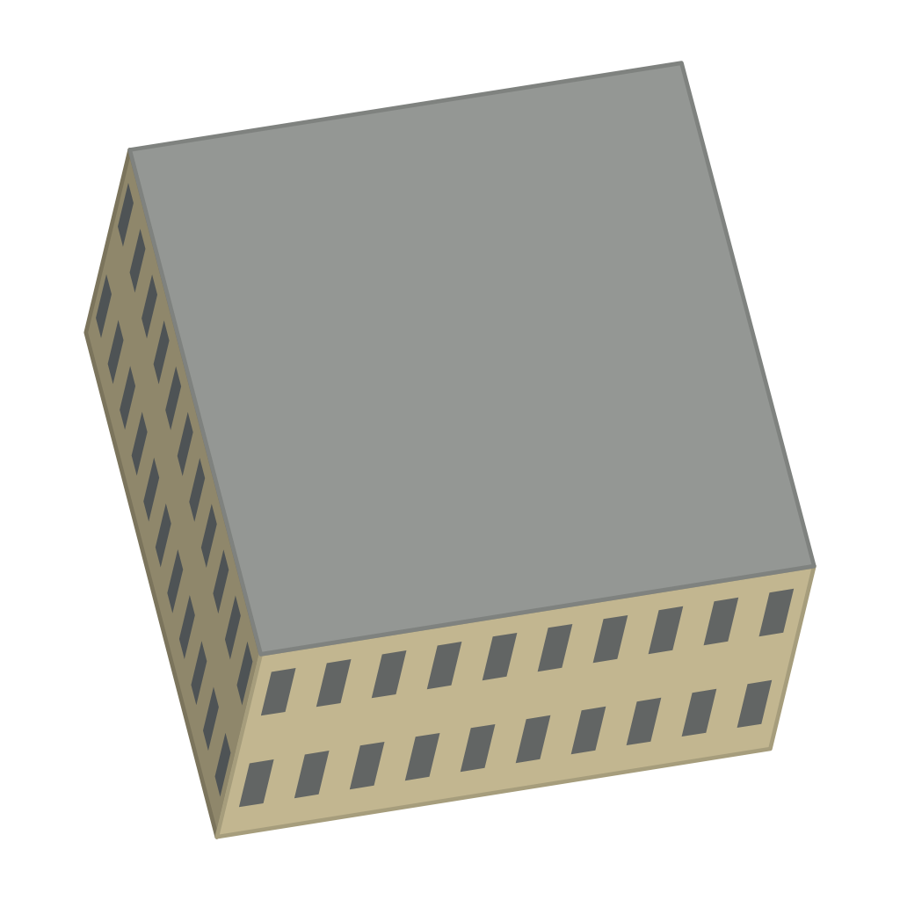

# Кинотеатр «Колизей»

<!-- Файл собирает scripts/art/art.py readme: правьте info.json (заметки, фото) и style.txt. -->

|         |                                                                 |
| ------- | --------------------------------------------------------------- |
| Модель  | [`models/kolizey.json`](../../src/map/data/models/kolizey.json) |
| Адрес   | пр. Ленина, 43                                                  |
| OSM     | [way/47983930](https://www.openstreetmap.org/way/47983930)      |
| Каркас  | 1024×1024, 18.628 px/м                                          |
| Рисунок | ещё нет                                                         |



## Как нарисовать

1. Скачайте каркас [`guide.png`](guide.png) (на странице файла — кнопка «Download raw file»).
   Если генератор плохо держит форму, попробуйте [`guide-lines.png`](guide-lines.png) или
   [`guide-clay.png`](guide-clay.png).
2. Подберите 1–3 фото здания (ссылки ниже), лучше — с юга или юго-запада.
3. В ChatGPT: приложите каркас **первым**, потом фото, и вставьте запрос. Если есть удачный
   рисунок другого здания, приложите его последним и допишите: «Стиль — как на последней
   картинке».
4. Сохраните результат и загрузите его в папку [`drawn/`](https://github.com/alexkof/ekbgame/upload/main/art/kolizey/drawn)
   (Add file → Upload files). Через пару минут рисунок встанет на карту:
   https://alexkof.github.io/ekbgame/ (а проверка совмещения — `check.jpg` в этой папке).

## Запрос

```text
Нарисуй здание «Кинотеатр «Колизей», пр. Ленина, 43, Екатеринбург» для карты-игры.

Картинка 1 — каркас: 3D-модель здания в проекции нашей карты. Это точная геометрия и кадр.
Картинка 2 — фотография этого здания (photos/kinoteatr-kolizey.jpg): облик, цвета, материалы, окна, декор.
Если последней приложена картинка «образец стиля» (art/style-ref.png) — это рисунок другого здания нашей карты: рисуй в точно таком же стиле (контуры, палитра, светотень, детализация), но здание — своё.

Как рисовать:
- Формат — квадрат 1024×1024, как у картинки 1. Сохрани кадр картинки 1: та же камера, то же положение, размер и силуэт здания. Не поворачивай, не сдвигай, не масштабируй, не добавляй перспективу: вертикали остаются вертикальными и наклонены вправо так же, как на каркасе, параллельные линии остаются параллельными.
- Нарисуй по каркасу настоящее здание по фотографиям: материалы, цвет, окна, двери, карнизы, декор, форму и цвет крыши. Мелкие детали (башенки, купола, шпили, балконы, козырьки), которых нет на каркасе, добавь, если они есть на фото.
- Камера смотрит с юга сверху. На каркасе видны стены, обращённые к западу (40 м), к югу (34 м). На фото может быть другая сторона здания: рисуй те стены, что видны на каркасе, — как они выглядят в жизни; если их нет на фото, додумай в том же стиле.
- Свет сверху с юго-юго-востока: стены, обращённые на юг (на картинке — нижние), светлые; западные (левые) — в тени.
- Фон — сплошной чисто-белый. Без земли и травы вокруг, без падающих теней, деревьев, людей, машин, подписей и рамки.
- Стиль: нарядная детальная иллюстрация для градостроительной игры: аккуратные чёткие контуры, чистые плоские цвета с мягкой светотенью, чуть упрощённые, но узнаваемые детали (окна, наличники, карнизы, вывески), тёплая дневная палитра. Без фотореализма, без зернистости и шума, без размытия.

О здании: построено: 1847; этажей: 2; высота стен до 12 м.

Важно: Здание 1847 года (первый городской театр), с 1920-х — кинотеатр. Классицизм: светло-жёлтые кремовые стены, белые колонны-портики на углах, высокие арочные окна, белая лепнина и карнизы, два высоких этажа. На крыше — большие синие буквы «КИНОМАКС».
```

## Фото

- [`photos/kinoteatr-kolizey.jpg`](photos/kinoteatr-kolizey.jpg) — Владислав Фальшивомонетчик, CC BY-SA 3.0 ([источник](https://commons.wikimedia.org/wiki/File:%D0%9A%D0%B8%D0%BD%D0%BE%D1%82%D0%B5%D0%B0%D1%82%D1%80_%D0%9A%D0%BE%D0%BB%D0%B8%D0%B7%D0%B5%D0%B9.jpg))
- [Викисклад: Coliseum cinema in Yekaterinburg (September 2026) - 2.jpg](https://commons.wikimedia.org/wiki/File:Coliseum_cinema_in_Yekaterinburg_%28September_2026%29_-_2.jpg)
- [Викисклад: категория «Coliseum cinema Ekaterinburg»](https://commons.wikimedia.org/wiki/Category:Coliseum_cinema_Ekaterinburg)
- [Википедия: Колизей (кинотеатр, Екатеринбург)](https://ru.wikipedia.org/wiki/%D0%9A%D0%BE%D0%BB%D0%B8%D0%B7%D0%B5%D0%B9_%28%D0%BA%D0%B8%D0%BD%D0%BE%D1%82%D0%B5%D0%B0%D1%82%D1%80%2C_%D0%95%D0%BA%D0%B0%D1%82%D0%B5%D1%80%D0%B8%D0%BD%D0%B1%D1%83%D1%80%D0%B3%29)
- [Яндекс Панорамы (найдите вид с юга или юго-запада)](https://yandex.ru/maps/?ll=60.610698%2C56.839632&z=18&l=stv%2Csta)
- [Google Street View](https://www.google.com/maps/@?api=1&map_action=pano&viewpoint=56.839632%2C60.610698)
- [PastVu — старые фото](https://pastvu.com/?g=56.839632,60.610698&z=18&s=osm&t=mapnik&type=1)
- [Яндекс Картинки](https://yandex.ru/images/search?text=%D0%9A%D0%B8%D0%BD%D0%BE%D1%82%D0%B5%D0%B0%D1%82%D1%80%20%C2%AB%D0%9A%D0%BE%D0%BB%D0%B8%D0%B7%D0%B5%D0%B9%C2%BB%20%D0%BF%D1%80.%20%D0%9B%D0%B5%D0%BD%D0%B8%D0%BD%D0%B0%2C%2043%20%D0%95%D0%BA%D0%B0%D1%82%D0%B5%D1%80%D0%B8%D0%BD%D0%B1%D1%83%D1%80%D0%B3)
- [OpenStreetMap: way/47983930](https://www.openstreetmap.org/way/47983930)
