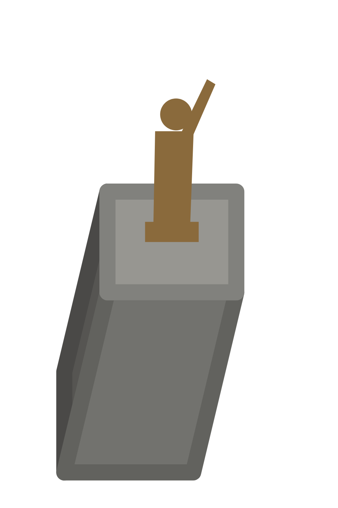

# Памятник А. С. Попову

<!-- Файл собирает scripts/art/art.py readme: правьте info.json (заметки, фото) и style.txt. -->

|         |                                                                               |
| ------- | ----------------------------------------------------------------------------- |
| Модель  | [`models/popov-monument.json`](../../src/map/data/models/popov-monument.json) |
| OSM     | [node/470138069](https://www.openstreetmap.org/node/470138069)                |
| Каркас  | 1024×1536, 195.177 px/м                                                       |
| Рисунок | ещё нет                                                                       |



## Как нарисовать

1. Скачайте каркас [`guide.png`](guide.png) (на странице файла — кнопка «Download raw file»).
   Если генератор плохо держит форму, попробуйте [`guide-lines.png`](guide-lines.png) или
   [`guide-clay.png`](guide-clay.png).
2. Подберите 1–3 фото здания (ссылки ниже), лучше — с юга или юго-запада.
3. В ChatGPT: приложите каркас **первым**, потом фото, и вставьте запрос. Если есть удачный
   рисунок другого здания, приложите его последним и допишите: «Стиль — как на последней
   картинке».
4. Сохраните результат и загрузите его в папку [`drawn/`](https://github.com/alexkof/ekbgame/upload/main/art/popov-monument/drawn)
   (Add file → Upload files). Через пару минут рисунок встанет на карту:
   https://alexkof.github.io/ekbgame/ (а проверка совмещения — `check.jpg` в этой папке).

## Запрос

```text
Нарисуй здание «Памятник А. С. Попову, Екатеринбург» для карты-игры.

Картинка 1 — каркас: 3D-модель здания в проекции нашей карты. Это точная геометрия и кадр.
Картинка 2 — фотография этого здания (photos/architecture-of-yekaterinburg-june-22-11.jpg): облик, цвета, материалы, окна, декор.
Если последней приложена картинка «образец стиля» (art/style-ref.png) — это рисунок другого здания нашей карты: рисуй в точно таком же стиле (контуры, палитра, светотень, детализация), но здание — своё.

Как рисовать:
- Формат — вертикальный 2:3, 1024×1536, как у картинки 1. Сохрани кадр картинки 1: та же камера, то же положение, размер и силуэт здания. Не поворачивай, не сдвигай, не масштабируй, не добавляй перспективу: вертикали остаются вертикальными и наклонены вправо так же, как на каркасе, параллельные линии остаются параллельными.
- Нарисуй по каркасу настоящее здание по фотографиям: материалы, цвет, окна, двери, карнизы, декор, форму и цвет крыши. Мелкие детали (башенки, купола, шпили, балконы, козырьки), которых нет на каркасе, добавь, если они есть на фото.
- Камера смотрит с юга сверху. На каркасе видны стены, обращённые к югу (2 м), к западу (2 м). На фото может быть другая сторона здания: рисуй те стены, что видны на каркасе, — как они выглядят в жизни; если их нет на фото, додумай в том же стиле.
- Свет сверху с юго-юго-востока: стены, обращённые на юг (на картинке — нижние), светлые; западные (левые) — в тени.
- Фон — сплошной чисто-белый. Без земли и травы вокруг, без падающих теней, деревьев, людей, машин, подписей и рамки.
- Стиль: нарядная детальная иллюстрация для градостроительной игры: аккуратные чёткие контуры, чистые плоские цвета с мягкой светотенью, чуть упрощённые, но узнаваемые детали (окна, наличники, карнизы, вывески), тёплая дневная палитра. Без фотореализма, без зернистости и шума, без размытия.

О здании: высота стен до 3 м.

Важно: Бронзовая фигура А. С. Попова, сидящего в кресле, на высоком прямоугольном постаменте из серого гранита с надписью. Только памятник и постамент — без клумб, плиток и деревьев вокруг.
```

## Фото

- [`photos/architecture-of-yekaterinburg-june-22-11.jpg`](photos/architecture-of-yekaterinburg-june-22-11.jpg) — Vyacheslav Bukharov, CC BY-SA 4.0 ([источник](https://commons.wikimedia.org/wiki/File:Architecture_of_Yekaterinburg_%28June_%2722%29_-_11.jpg))
- [Викисклад: категория «Monument to Alexander Popov in Yekaterinburg»](https://commons.wikimedia.org/wiki/Category:Monument_to_Alexander_Popov_in_Yekaterinburg)
- [Википедия: Памятник А. С. Попову (Екатеринбург)](https://ru.wikipedia.org/wiki/%D0%9F%D0%B0%D0%BC%D1%8F%D1%82%D0%BD%D0%B8%D0%BA_%D0%90._%D0%A1._%D0%9F%D0%BE%D0%BF%D0%BE%D0%B2%D1%83_%28%D0%95%D0%BA%D0%B0%D1%82%D0%B5%D1%80%D0%B8%D0%BD%D0%B1%D1%83%D1%80%D0%B3%29)
- [Яндекс Панорамы (найдите вид с юга или юго-запада)](https://yandex.ru/maps/?ll=60.607769%2C56.839578&z=18&l=stv%2Csta)
- [Google Street View](https://www.google.com/maps/@?api=1&map_action=pano&viewpoint=56.839578%2C60.607769)
- [PastVu — старые фото](https://pastvu.com/?g=56.839578,60.607769&z=18&s=osm&t=mapnik&type=1)
- [Яндекс Картинки](https://yandex.ru/images/search?text=%D0%9F%D0%B0%D0%BC%D1%8F%D1%82%D0%BD%D0%B8%D0%BA%20%D0%90.%20%D0%A1.%20%D0%9F%D0%BE%D0%BF%D0%BE%D0%B2%D1%83%20%D0%95%D0%BA%D0%B0%D1%82%D0%B5%D1%80%D0%B8%D0%BD%D0%B1%D1%83%D1%80%D0%B3)
- [OpenStreetMap: node/470138069](https://www.openstreetmap.org/node/470138069)
