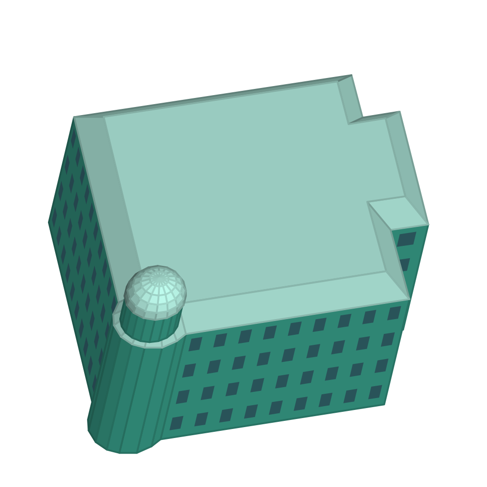

# Дом Севастьянова

<!-- Файл собирает scripts/art/art.py readme: правьте info.json (заметки, фото) и style.txt. -->

|         |                                                                                     |
| ------- | ----------------------------------------------------------------------------------- |
| Модель  | [`models/sevastyanov-house.json`](../../src/map/data/models/sevastyanov-house.json) |
| Адрес   | пр. Ленина, 35                                                                      |
| OSM     | [way/51503505](https://www.openstreetmap.org/way/51503505)                          |
| Каркас  | 1024×1024, 14.691 px/м                                                              |
| Рисунок | ещё нет                                                                             |



## Как нарисовать

1. Скачайте каркас [`guide.png`](guide.png) (на странице файла — кнопка «Download raw file»).
   Если генератор плохо держит форму, попробуйте [`guide-lines.png`](guide-lines.png) или
   [`guide-clay.png`](guide-clay.png).
2. Подберите 1–3 фото здания (ссылки ниже), лучше — с юга или юго-запада.
3. В ChatGPT: приложите каркас **первым**, потом фото, и вставьте запрос. Если есть удачный
   рисунок другого здания, приложите его последним и допишите: «Стиль — как на последней
   картинке».
4. Сохраните результат и загрузите его в папку [`drawn/`](https://github.com/alexkof/ekbgame/upload/main/art/sevastyanov-house/drawn)
   (Add file → Upload files). Через пару минут рисунок встанет на карту:
   https://alexkof.github.io/ekbgame/ (а проверка совмещения — `check.jpg` в этой папке).

## Запрос

```text
Нарисуй здание «Дом Севастьянова, пр. Ленина, 35, Екатеринбург» для карты-игры.

Картинка 1 — каркас: 3D-модель здания в проекции нашей карты. Это точная геометрия и кадр.
Картинка 2 — фотография этого здания (photos/e-burg-asv2019-05-img27-sevastianov-manor.jpg): облик, цвета, материалы, окна, декор.
Если последней приложена картинка «образец стиля» (art/style-ref.png) — это рисунок другого здания нашей карты: рисуй в точно таком же стиле (контуры, палитра, светотень, детализация), но здание — своё.

Как рисовать:
- Формат — квадрат 1024×1024, как у картинки 1. Сохрани кадр картинки 1: та же камера, то же положение, размер и силуэт здания. Не поворачивай, не сдвигай, не масштабируй, не добавляй перспективу: вертикали остаются вертикальными и наклонены вправо так же, как на каркасе, параллельные линии остаются параллельными.
- Нарисуй по каркасу настоящее здание по фотографиям: материалы, цвет, окна, двери, карнизы, декор, форму и цвет крыши. Мелкие детали (башенки, купола, шпили, балконы, козырьки), которых нет на каркасе, добавь, если они есть на фото.
- Камера смотрит с юга сверху. На каркасе видны стены, обращённые к югу (43 м), к западу (37 м), к юго-западу (4 м). На фото может быть другая сторона здания: рисуй те стены, что видны на каркасе, — как они выглядят в жизни; если их нет на фото, додумай в том же стиле.
- Свет сверху с юго-юго-востока: стены, обращённые на юг (на картинке — нижние), светлые; западные (левые) — в тени.
- Фон — сплошной чисто-белый. Без земли и травы вокруг, без падающих теней, деревьев, людей, машин, подписей и рамки.
- Стиль: нарядная детальная иллюстрация для градостроительной игры: аккуратные чёткие контуры, чистые плоские цвета с мягкой светотенью, чуть упрощённые, но узнаваемые детали (окна, наличники, карнизы, вывески), тёплая дневная палитра. Без фотореализма, без зернистости и шума, без размытия.

О здании: построено: 1829, 1863–1866; этажей: 4; высота стен до 20 м.

Важно: Бирюзово-зелёные стены с белым кружевным декором (псевдоготика: стрельчатые наличники, пинакли, балюстрада), светло-бирюзовая крыша. На юго-западном углу — полукруглая ротонда с высокими стрельчатыми окнами, над ней бельведер со светло-бирюзовым куполом. Главный фасад — на юг, к пр. Ленина. Два высоких этажа над цоколем.
```

## Фото

- [`photos/e-burg-asv2019-05-img27-sevastianov-manor.jpg`](photos/e-burg-asv2019-05-img27-sevastianov-manor.jpg) — A.Savin, Free Art License ([источник](https://commons.wikimedia.org/wiki/File:E-burg_asv2019-05_img27_Sevastianov_Manor.jpg))
- [Викисклад: категория «Sevastyanov's Mansion»](https://commons.wikimedia.org/wiki/Category:Sevastyanov%27s_Mansion)
- [Википедия: Дом Севастьянова](https://ru.wikipedia.org/wiki/%D0%94%D0%BE%D0%BC_%D0%A1%D0%B5%D0%B2%D0%B0%D1%81%D1%82%D1%8C%D1%8F%D0%BD%D0%BE%D0%B2%D0%B0)
- [Яндекс Панорамы (найдите вид с юга или юго-запада)](https://yandex.ru/maps/?ll=60.606094%2C56.839137&z=18&l=stv%2Csta)
- [Google Street View](https://www.google.com/maps/@?api=1&map_action=pano&viewpoint=56.839137%2C60.606094)
- [PastVu — старые фото](https://pastvu.com/?g=56.839137,60.606094&z=18&s=osm&t=mapnik&type=1)
- [Яндекс Картинки](https://yandex.ru/images/search?text=%D0%94%D0%BE%D0%BC%20%D0%A1%D0%B5%D0%B2%D0%B0%D1%81%D1%82%D1%8C%D1%8F%D0%BD%D0%BE%D0%B2%D0%B0%20%D0%BF%D1%80.%20%D0%9B%D0%B5%D0%BD%D0%B8%D0%BD%D0%B0%2C%2035%20%D0%95%D0%BA%D0%B0%D1%82%D0%B5%D1%80%D0%B8%D0%BD%D0%B1%D1%83%D1%80%D0%B3)
- [OpenStreetMap: way/51503505](https://www.openstreetmap.org/way/51503505)
