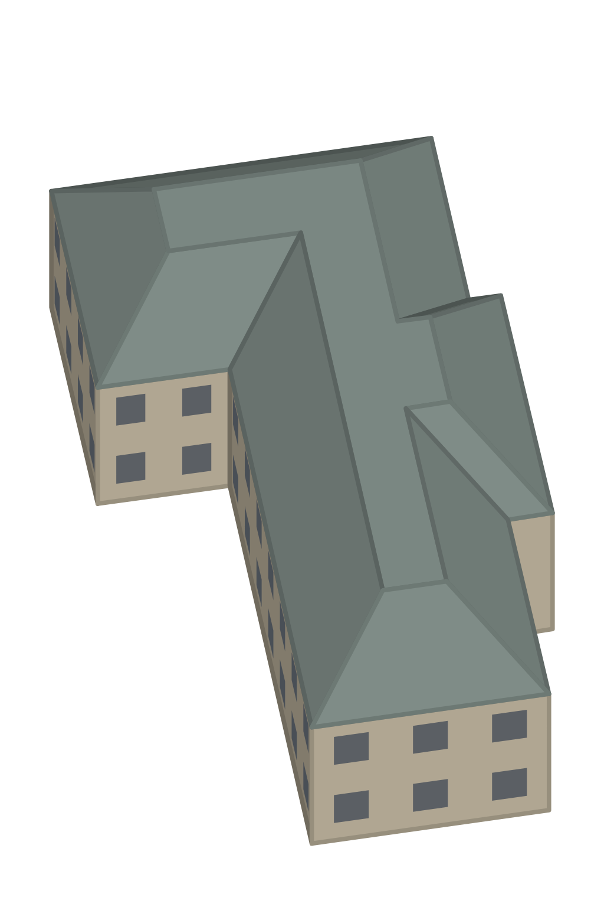
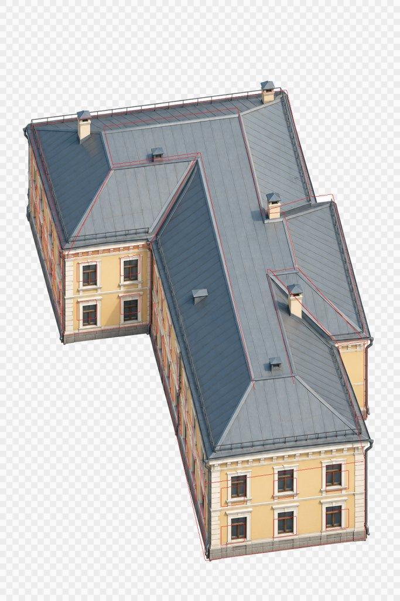

# ул. Толмачёва, 21

<!-- Файл собирает scripts/art/art.py readme: правьте info.json (заметки, фото) и style.txt. -->

|         |                                                                                                                              |
| ------- | ---------------------------------------------------------------------------------------------------------------------------- |
| Модель  | [`models/tolmacheva-21.json`](../../src/map/data/models/tolmacheva-21.json)                                                  |
| Адрес   | ул. Толмачёва, 21                                                                                                            |
| OSM     | [way/51503513](https://www.openstreetmap.org/way/51503513)                                                                   |
| Каркас  | 1024×1536, 30.236 px/м                                                                                                       |
| Рисунок | [`tolmacheva-21/art.webp`](../../src/map/data/models/tolmacheva-21/art.webp) из `art/tolmacheva-21/drawn/codex-20261102.png` |



## Как нарисовать

1. Скачайте каркас [`guide.png`](guide.png) (на странице файла — кнопка «Download raw file»).
   Если генератор плохо держит форму, попробуйте [`guide-lines.png`](guide-lines.png) или
   [`guide-clay.png`](guide-clay.png).
2. Подберите 1–3 фото здания (ссылки ниже), лучше — с юга или юго-запада.
3. В ChatGPT: приложите каркас **первым**, потом фото, и вставьте запрос. Если есть удачный
   рисунок другого здания, приложите его последним и допишите: «Стиль — как на последней
   картинке».
4. Вместе с результатом сохраните копию использованного до генерации `frame.json` как
   `<имя рисунка>.frame.json`. Загрузите оба файла в папку [`drawn/`](https://github.com/alexkof/ekbgame/upload/main/art/tolmacheva-21/drawn)
   (Add file → Upload files). Через пару минут рисунок встанет на карту:
   https://alexkof.github.io/ekbgame/ (а проверка совмещения — `check.jpg` в этой папке).

## Запрос

```text
Нарисуй здание «ул. Толмачёва, 21, ул. Толмачёва, 21, Екатеринбург» для карты-игры.

Картинка 1 — каркас: 3D-модель здания в проекции нашей карты. Это точная геометрия и кадр.
Фотографии (если приложены) — облик этого здания: цвета, материалы, окна, декор. Если фото нет, рисуй по каркасу и описанию ниже, в духе исторического центра Екатеринбурга.
Если последней приложена картинка «образец стиля» (art/style-ref.png) — это рисунок другого здания нашей карты: рисуй в точно таком же стиле (контуры, палитра, светотень, детализация), но здание — своё.

Как рисовать:
- Формат — вертикальный 2:3, 1024×1536, как у картинки 1. Сохрани кадр картинки 1: та же камера, то же положение, размер и силуэт здания. Не поворачивай, не сдвигай, не масштабируй, не добавляй перспективу: все вертикальные линии строго вертикальны на экране, параллельные линии остаются параллельными.
- Обязательная проверка: углы стен, края окон и дверей, колонны, башни и шпили идут строго сверху вниз, без наклона вправо или влево и без схождения к точке перспективы. Проверь по вертикальным направляющим левую, центральную и правую части здания от основания до верха. Не переноси заваленные вертикали с фото или старого образца стиля; исправь их перед выдачей результата.
- Проверь отдельно каждое боковое крыло: у вертикального ребра верхняя и нижняя точки имеют одинаковую координату X. Одной правильной башни недостаточно. Наклонные линии крыши и земли, уходящие в глубину, не являются вертикалями — их направление сохраняй как у каркаса.
- Нарисуй по каркасу настоящее здание по фотографиям: материалы, цвет, окна, двери, карнизы, декор, форму и цвет крыши. Мелкие детали (башенки, купола, шпили, балконы, козырьки), которых нет на каркасе, добавь, если они есть на фото.
- Камера смотрит с юга сверху. На каркасе видны стены, обращённые к западу (40 м), к югу (24 м). На фото может быть другая сторона здания: рисуй те стены, что видны на каркасе, — как они выглядят в жизни; если их нет на фото, додумай в том же стиле.
- Свет сверху с юго-юго-востока: стены, обращённые на юг (на картинке — нижние), светлые; западные (левые) — в тени.
- Фон — сплошной чисто-белый. Без земли и травы вокруг, без падающих теней, деревьев, людей, машин, подписей и рамки.
- Стиль: фотореалистичный детальный рендер для современной градостроительной игры с высоты птичьего полёта, как на изображении исходного прототипа (art/style-ref.png): естественные материалы штукатурки, камня, металла и стекла, узнаваемые окна, наличники, карнизы и декор, тёплый летний дневной свет с юго-юго-востока. Чёткие детали, мягкая светотень, без рисованной обводки, мультяшных плоских заливок, зернистости и размытия. Стиль референса не меняет камеру, силуэт и строго вертикальные рёбра каркаса.

О здании: этажей: 2; высота стен до 7 м.
```

## Фото

- [Яндекс Панорамы (найдите вид с юга или юго-запада)](https://yandex.ru/maps/?ll=60.608735%2C56.840174&z=18&l=stv%2Csta)
- [Google Street View](https://www.google.com/maps/@?api=1&map_action=pano&viewpoint=56.840174%2C60.608735)
- [PastVu — старые фото](https://pastvu.com/?g=56.840174,60.608735&z=18&s=osm&t=mapnik&type=1)
- [Яндекс Картинки](https://yandex.ru/images/search?text=%D1%83%D0%BB.%20%D0%A2%D0%BE%D0%BB%D0%BC%D0%B0%D1%87%D1%91%D0%B2%D0%B0%2C%2021%20%D1%83%D0%BB.%20%D0%A2%D0%BE%D0%BB%D0%BC%D0%B0%D1%87%D1%91%D0%B2%D0%B0%2C%2021%20%D0%95%D0%BA%D0%B0%D1%82%D0%B5%D1%80%D0%B8%D0%BD%D0%B1%D1%83%D1%80%D0%B3)
- [OpenStreetMap: way/51503513](https://www.openstreetmap.org/way/51503513)

## Проверка совмещения

Рисунок на карте; красным — контуры каркаса.


